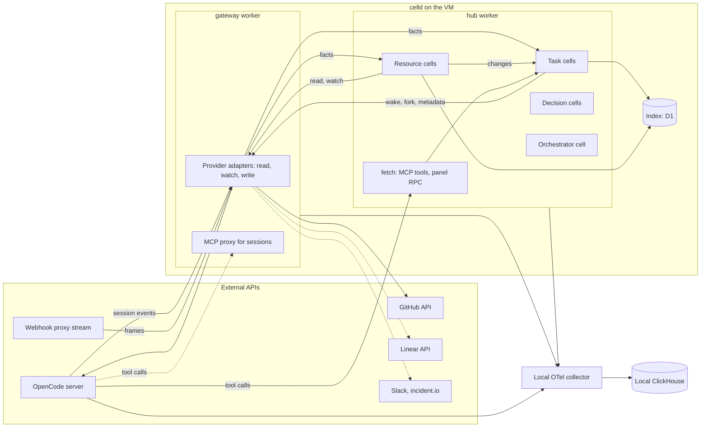
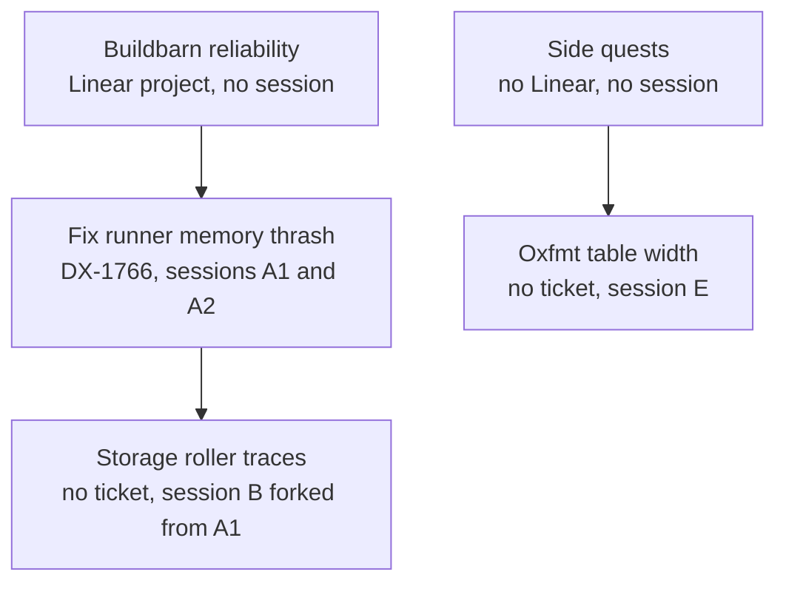

# Ratchet design

A tree of tasks, each tied to its OpenCode sessions, with every external
resource a task touches attached to it. Tasks and resources are cells: typed
actors with a state machine, a durable inbox and an outbox. Ratchet wakes the
session or person who acts next.

The wider plan it belongs to (the coordinator session, the Desktop panel, the
backlog) is in `agent-setup/README.md` in `dotfiles-lovable`.

The first iteration runs: the session tree is mirrored into tasks. See
[Built so far](#built-so-far).

## Decided

| Topic | Decision |
| --- | --- |
| Build or reuse | Build our own, in this private repo |
| Programming model | Cloudflare Workers and Durable Objects, on celld, from the start |
| Where it runs | Local on the dev VM. Nothing on shared Lovable infra for now |
| Language | TypeScript with Effect v4. Every record is a tagged union |
| Logic | State machines with `effect-machine` |
| Unit of work | A task. Tasks form a tree. Tasks and sessions are many to many, a session works on one task at a time, and forking a session forks the task by default |
| Runtime mode | `celld dev`, with its local store |
| GitHub credential | A fine-grained token to start |
| External systems | Reached only as APIs, in and out of the gateway worker, OpenCode included. No `gh`, `lov` or other local CLI. The hub worker does no outbound I/O |
| Telemetry | OpenTelemetry traces for everything, OpenCode's included, through a collector that is local and ours alone, stored in a local ClickHouse |
| How we build | One thing, iterated. No separate spikes |

## Architecture

Dashed parts come later. Every external system is reached through the gateway,
OpenCode and GitHub included. Sessions call the hub as an MCP server on
loopback. OpenCode sends the session ID with every tool call, so a tool never
takes a session or task ID from the model.

## Tasks

| Field | Type | Rule |
| --- | --- | --- |
| Parent | Task, or none for a root | One parent. The tree has no cycles |
| Sessions | Zero or more OpenCode sessions | A session can work on several tasks over its life, on one at a time. A task without a session is a group, such as a project |
| Linear | Project, issue, or none | One to one. A Linear entity belongs to at most one task |
| Attachments | Set of resource and relation | Relation is `Owns`, `WaitsOn` or `Context` |
| State | `NeedsMe`, `Working`, `Watching`, `Idle`, later `Done` and `Archived` | One machine per task. The tag is what the board shows |

**Fork.** OpenCode's fork copies a session's history up to a message into a new
session, which records the session it came from and the fork point in its `fork`
field. By default the task forks with it: the forked session gets a new task, a
child of the task that owns the original session. A fork I make in the desktop
app and a fork the hub makes through the API produce the same event and the same
result. The hub writes the task ID into the session's metadata, so the mapping
is stored on both sides.

**Current task.** A session has one current task. What it does is recorded
against that task: a PR it registers, a decision it raises, a resource it
attaches. When a session starts on something else, its current task changes and
the hub records the span of messages each task covered. So a session that did
three things holds three tasks, and each task knows which part of the session
was its own.

**Toward one task per session.** A session holding several tasks is the case to
shrink. A session changes its current task with a tool. It also has a tool to
fork, and instructions to fork when a significant task can be done separately.
The orchestrator forks too, on its own: when a session's current task changes,
it can fork the session at that message, so the new task continues in a session
of its own. A wake-up names the task it belongs to. When it arrives for a task
that is not the session's current one, that is a second point to fork.

**Correcting a link.** The automatic links are sometimes wrong: a fork made to
try another approach to the same task gets a new task by default, or a session
is filed under the wrong project. Changing a session's current task, or which
task a span belongs to, fixes that.

Compaction keeps the same session and changes nothing here.

**Linear.** A project maps to a group task, an issue to a task, a sub-issue to a
child task. A fork starts with no Linear entity. Creating one stays a proposal,
as decided for all new issues.

**Subagent sessions** are the ones with a `parentID`. They never start a task. A
running subagent is recorded on the task of the main session it works for,
however deep it nests, with a kind: `working`, or `watching` for one that
monitors something and does no work on the task. The hub sees a subagent start
and stop. Only the owning session knows what it is for, so the session declares
the kind with a tool. Long implementation work is meant to happen in main
sessions that the orchestrator manages, so subagents get this lighter record and
no task of their own.

**What the state says.** The tag is derived from the task's details, in this
order: an open question form or permission request makes it `NeedsMe`, a running
main session or a working subagent makes it `Working`, a subagent that only
watches makes it `Watching`, and otherwise it is `Idle`. A question wins over
running work, so a task whose subagent runs while the main agent waits on me
reads `NeedsMe`.

## Resources

Every external thing is a resource cell, keyed by a canonical reference. The
cell holds the latest known facts, the tasks attached to it and their relation,
and for an exclusive kind its one owner. Attaching subscribes the task to the
resource's changes.

| Kind | Key | Facts arrive by | Read by | Exclusive |
| --- | --- | --- | --- | --- |
| Pull request | repo and number | Webhook proxy frame, then a read | Gateway | No |
| Linear issue | its identifier, such as DX-1550 | Polling | Gateway | One task owns it; others may wait on it |
| Slack thread or DM | channel and timestamp | Polling | Gateway | No |
| incident.io incident | the number of its reference | Polling | Gateway | No |
| Other link | URL | Nothing | Nothing | No |

Uniqueness needs no lock: the resource cell handles one message at a time, so it
refuses a second owner itself.

## From GitHub frames to wake-ups

One push to a PR in the monorepo produces about a hundred frames: each of some
46 checks starts and finishes, bots post and edit comments, and the session's
own replies appear under my login. A wake-up costs a model turn, so most of this
must not wake anything. Three layers reduce it, and none is a free-form filter.

| Layer | Turns | Into | How |
| --- | --- | --- | --- |
| GitHub adapter | Frames | Facts: a snapshot of head, checks, reviews and threads | A read after a frame, with a short debounce. No judgement. A frame for a passed check needs no read |
| PR resource cell | Fact snapshots | Typed changes | A state machine. CI per head goes `Absent` (no check has reported), `Running`, `Failing`, `Finished`, so it emits at most two changes per head: the first failure and the end |
| Subscription | Changes | Wake-ups | A change that a task can act on becomes a message in the task's outbox, naming the task. The hub hands it to the gateway, which admits it to the session as a synthetic message, and the message leaves the outbox once OpenCode has it. Each wake-up has one message ID, derived from its queue time and a hash, so a retry adds no second message. `WAKE_SESSIONS` limits which sessions are woken |

| Change | Wakes an owner | Note |
| --- | --- | --- |
| First required check fails on a head | Yes | Later failures on the same head wait for the end |
| CI ends on a head | Yes | With the checks that failed, or passed after failing |
| A person submits a review or opens a thread | Yes | |
| A bot opens a thread with a finding | Yes | |
| A thread is resolved | No | Sent with the next wake-up |
| Bot boilerplate, an edited bot summary, a comment a newer one replaced | No | Sent with the next wake-up, or dropped |
| The session's own reply | No | Posted under my login, recognised by its footer |
| My own comment | Yes | It is how I steer a session from GitHub |
| Merge conflict, removed from the merge queue | Yes | |
| Merged or closed | Yes | Also wakes tasks that wait on it |

The CI rows are mechanical and cover most frames. The comment rows are
heuristics about authors and text. `lov pr watch` has tuned such rules in Go
(`go/cli/internal/commands/pr` in the monorepo), which can't be imported here.
Start with the CI machine and a short list of bot authors, measure wake-ups per
PR from the traces, and add a comment rule when the traces show its noise.

## Cells

| Cell | One per | Machine | Wakes on |
| --- | --- | --- | --- |
| Task | Task | Lifecycle above | Session events, changes to attached resources, answers |
| Resource | External thing | Per kind, such as `Open(head, ci, review)`, `Merged`, `Closed` | Frames, its polling alarm, attach and detach |
| Decision | Question raised | `Open`, `Answered`, `Acted`, `Superseded` | My answer, its default timer |
| Orchestrator | Me | `Quiet`, `HasWork` | Stalls, tasks to group, defaults that fired |

The index is a read model in D1, written from cell events. The panel and the
orchestrator query it. No query fans out over cells.

## APIs in and out

| System | In | Out | Credential |
| --- | --- | --- | --- |
| OpenCode | Event stream | HTTP API on loopback: wake a session, fork, set metadata | The local service's credential |
| GitHub | Webhook proxy stream | REST and GraphQL | A token from the settings. GitHub's sign-in takes no client that registers itself, so OAuth there needs an app of its own |
| Webhook proxy | Its stream | OAuth at `lovable.dev/oauth`, then `watch_events` or the direct stream URL | One OAuth grant with a refresh token |
| Linear, incident.io, Buildkite | Polling | Their MCP servers over HTTP | An OAuth sign-in each, renewed by the gateway |
| Slack | Polling | Its MCP server over HTTP | OAuth |

The proxy accepts a bearer token whose audience names the app, which an OAuth
token for its MCP resource does. Read from its source, not tested.

## The gateway

A second worker that holds every outside connection and credential. It has one
adapter per provider, and each adapter offers the same three operations: read a
resource, watch a set of resources, and write. Whether an adapter calls a REST
API, a GraphQL API or the provider's MCP server is private to it. The hub knows
typed references and facts, holds no credential and makes no outbound call, so
it can be tested against a fake gateway.

Watching differs per provider only inside the adapter: the OpenCode adapter
holds its event stream, the GitHub adapter holds the webhook proxy stream and
reads after a frame, and the others poll. An adapter that holds a stream is a
Durable Object in the gateway, with an alarm that reconnects it.

The one inbound path that skips the gateway is a session calling the hub's own
MCP tools.

Later the gateway can also be the MCP proxy sessions use for these providers.
That would let the hub attach a resource when a session first touches it and
apply policy to writes. It also makes the gateway a single point of failure for
session tools, so that step waits until the gateway has run for a while.

## Runtime

- `@effect/platform-cloudflare` has a Wrangler path: a worker re-exports four
  Durable Object classes, binds them in `wrangler.jsonc`, and Effect Cluster
  entities then run one per object. celld deploys Wrangler projects. Marked
  experimental, added in 4.1.3. Not tried on celld.
- `effect-machine/cluster` turns a machine into an entity with typed `send`,
  `ask` and `watch`, and journals each event.
- The same package has a persisted queue and a workflow engine on Durable
  Objects, for the outbox and for timers.
- Ratchet runs under `celld dev`, which keeps state in a local store. A real
  celld node needs a cloud bucket.
- A lone node waits for its store on every write.
- celld v0.6.2 is beta. Some upgrades need the node stopped.
- `@opencode/plugin` pins `effect` 4.1.0 and the cells need 4.1.4 or later. The
  Desktop panel's plugin calls the hub over HTTP and shares only schemas.
- Alchemy deploys to Cloudflare's API and has nothing to manage while everything
  is local.

## Telemetry

One OpenTelemetry Collector on the VM, started by Nix, receiving OTLP on
loopback from three senders: the cells (`effect/observability`), celld itself
(`CELLD_OTEL=http://127.0.0.1:4318`) and OpenCode (the standard
`OTEL_EXPORTER_OTLP_*` variables, which its binary references; undocumented and
untested). Cluster envelopes carry trace and span IDs, so one trace follows an
event across cells. The collector writes to a ClickHouse on the VM, so a session
can query traces with SQL.

## First iteration

Mirror the session tree. The gateway's OpenCode adapter holds the event stream
and sends session facts to the hub. The hub makes a task for each session and a
child task for each fork, tracks `Active` and `Waiting` from execution events,
writes the task ID into session metadata, survives a restart, answers one query
that returns the tree, and traces all of it to the local collector. This touches
celld, both workers and the binding between them, the cluster classes,
`effect-machine`, an outbound stream, OpenCode's API and telemetry, and no other
provider. The second iteration adds the GitHub adapter.

## Built so far

| Piece | State |
| --- | --- |
| Task and session cells | Each is an `effect-machine` machine run as an Effect Cluster entity, one Durable Object each, under `celld dev` |
| Task state | `NeedsMe`, `Working`, `Watching` or `Idle`, from running sessions, running subagents, and open forms and permission requests |
| Cell persistence | `src/hub/persistence.ts` keeps each machine's journal in its own object's SQLite, and folds it into a snapshot past 50 events on a wake or 200 on an append |
| Gateway OpenCode adapter | One Durable Object holds the event stream, subscribed to lifecycle, form and permission events only. An alarm reconnects it after a restart. Each connect starts with a snapshot of all sessions |
| Session tree | A task per root session, a child task per fork |
| Session metadata | The gateway writes `ratchet.task` into each session's metadata, once, least recently updated first |
| Index | D1 table written after each task change. `GET /tree` returns the forest |
| Session tools | The hub serves MCP at `/mcp` with Effect's `McpServer`, request-scoped, over the 2026-07-28 protocol. Task tools: `task_current`, `task_start`, `task_fork`, `subagent_declare`. Pull request tools: `pr_register`, `pr_set_status`, `pr_list`, `pr_unregister`. A tool takes the calling session from the request metadata OpenCode sends |
| Pull requests | A session attaches a pull request to its task with a relation: `owns`, `waits_on` or `context`. A `PullRequest` cell holds what GitHub last said and which tasks follow it. `src/hub/pull-request.ts` turns two observations into typed changes, with CI reporting at most its first failure and its end per head. A pull request stays with its task when the session starts another one: a session remembers its earlier tasks, and the `pr_*` tools look through all of them |
| GitHub adapter | `src/gateway/github.ts` reads a pull request in one GraphQL call, with a classic token. A Durable Object reads every followed, open pull request once a minute. It stands in for the webhook proxy stream |
| Wake-ups | A change that a task can act on becomes a message in the task's outbox. The hub hands it to the gateway, which admits it to the session as a synthetic message, and the message leaves the outbox once OpenCode has it. `WAKE_SESSIONS` limits which sessions are woken, and is empty by default |
| Work status | `pr_set_status` records what a session says about its work on a pull request. `waiting-user` turns the task to `NeedsMe`, until the pull request merges or closes: an attachment records how its resource ended, and its status no longer counts after that |
| Checks | oxlint with the vendored anti-slop rules, rumdl, `tsc` and the tests, run by lefthook before each commit. The standards are the skills in `.agents/skills` |
| Structure | Each half is domain modules, application services, ports and adapters, wired as Effect layers at its composition roots. Failures are tagged errors, IDs are branded types, and secrets are redacted values. `AGENTS.md` has the table of which file is which |
| Deploy | The service runs from its own checkout. `scripts/deploy.sh` moves it to `origin/main` after the checks pass |
| Sign-ins | The gateway signs in to a system with OAuth, as an MCP client does: it asks the system where its sign-in server is, registers itself there as a client, and sends me to a browser once. `src/gateway/grant.ts` is the grant, and one Durable Object per system holds it and renews its token, so a refresh token that the system honours once is never used twice. The systems are the webhook proxy, Linear and incident.io. `GET /gateway/sign-ins` says where each stands |
| Linear issues and incidents | A task follows a Linear issue or an incident.io incident the way it follows a pull request: a cell per resource, an observation read by the gateway once a minute, typed changes, wake-ups by relation. `resource_register` takes an address or a short name. The gateway reads both through their MCP servers, signed in as me, and holds no key for either. Until someone signs in, reads of that kind fail and nothing else does. Read against stand-ins only so far: the real servers need the sign-ins |
| Builds of a commit | A fourth kind of resource: the Buildkite builds that a commit's arrival on its branch started, by the commit's hash. `src/gateway/buildkite.ts` lists the commit's builds through Buildkite's MCP server, leaves out builds on a schedule and the merge queue's, and reads the failed jobs of a failed build. The cell reports a build's first failure and its passing after a retry, and settles once every build has been over for a quarter of an hour, or after a day. When a pull request merges while a task follows it, the hub has every task that owns it follow the builds of its merge commit, so the session that merged a change hears when a build on the base branch fails. A commit that started no build adds nothing |
| Tracing | Spans over OTLP to the local collector when `OTLP_URL` is set. The collector and ClickHouse are user services in `dotfiles-lovable/nix/ratchet.nix` |

Differences from the design above, found while building:

- `celld dev` runs one script. The hub and the gateway are two entrypoints of
  that script, bound to each other with service bindings. They become two
  deployments on a real celld node.
- A trace does not cross cells yet. Spans inside an entity's Durable Object
  start a new trace, and so does the hub when the gateway calls it. The trace
  context has to be passed along by hand.
- A fork starts in the directory of the session it came from. The tool's
  instructions tell the caller to have the fork make its own worktree.
- A session that changes task does not record which messages belonged to which
  task. OpenCode sends the session ID with a tool call, not the message.
- Archived and deleted sessions are not handled. Their tasks stay.
- A cell's snapshot is the only record of the events folded into it, because
  folding deletes them. So a state or an event that gains a field gives it a
  decoding default, and `src/hub/stored-state.test.ts` holds one stored shape
  for each such field. Keeping the whole journal would lift this limit.
- A second `celld dev` against the same OpenCode service would write to the same
  sessions. `scripts/scratch.sh` runs a scratch Ratchet against a stand-in for
  OpenCode instead, so a change is tried end to end before the running service
  gets it.
- One pull request that could not be read stopped the reading of all the others.
  Each is now read on its own, and one that GitHub does not have is refused when
  a session registers it.
- No `ghprs` registration existed on this machine when the `pr_*` tools replaced
  those tools, so nothing was imported.
- The poller reads each pull request in full every minute, one after the other.
  That is 60 GraphQL calls an hour for each pull request, against a limit of
  5,000 points an hour.
- GitHub answers the first read of a pull request with mergeability `unknown`.
  The gateway reads once more after two seconds.
- The first observation of a pull request reports no changes. A session that
  registers a pull request whose CI already failed has to read that itself, with
  `pr_list`.
- The index is written by the code that applies a fact, after the cell answers.
  A failed write leaves a stale row until the task changes again.
- A snapshot of 146 sessions takes about 40 seconds on a clean start, because
  each cell write waits for the local store. Later snapshots send only what
  changed.
- OpenCode's port changes when its service restarts. `scripts/dev-vars.sh`
  rewrites `.dev.vars` from the service's registration file, and a systemd path
  unit runs it when that file changes.

## Open

1. Whether a fine-grained token can read everything the adapter needs on
   `lovablelabs/lovable`: checks, review threads and the merge queue.
