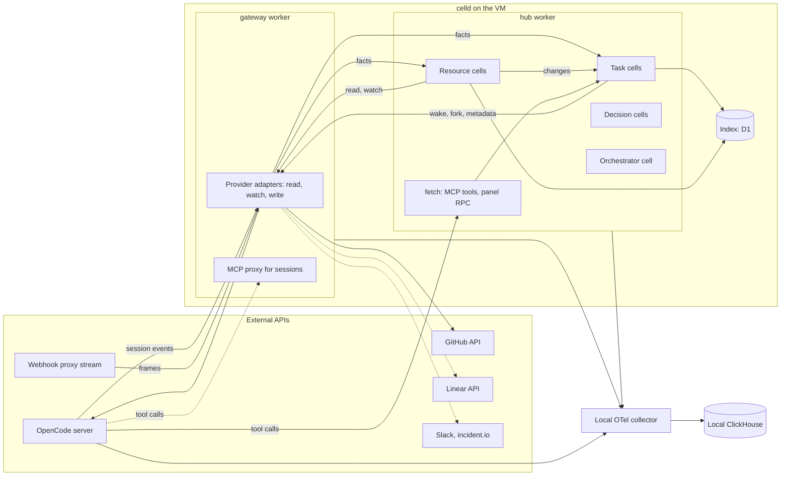
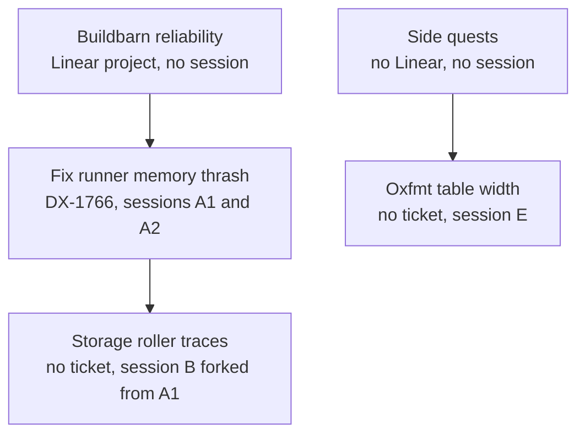

# Ratchet design

A tree of tasks, each tied to its OpenCode sessions, with every external
resource a task touches attached to it. Tasks and resources are cells: typed
actors with a state machine, a durable inbox and an outbox. Ratchet wakes the
session or person who acts next. This is a design. Nothing is built.

The wider plan it belongs to (the coordinator session, the Desktop panel, the
backlog) is in `agent-setup/README.md` in `dotfiles-lovable`.

## Decided

| Topic | Decision |
| --- | --- |
| Build or reuse | Build our own, in this private repo |
| Programming model | Cloudflare Workers and Durable Objects, on celld, from the start |
| Where it runs | Local on the dev VM. Nothing on shared Lovable infra for now |
| Language | TypeScript with Effect v4. Every record is a tagged union |
| Logic | State machines with `effect-machine` |
| Unit of work | A task. Tasks form a tree. A task has one or more sessions, and forking a session forks the task by default |
| External systems | Reached only as APIs, in and out of the gateway worker, OpenCode included. No `gh`, `lov` or other local CLI. The hub worker does no outbound I/O |
| Telemetry | OpenTelemetry traces for everything, OpenCode's included, through a collector that is local and ours alone, stored in a local ClickHouse |
| How we build | One thing, iterated. No separate spikes |

## Architecture

Dashed parts come later. Every external system is reached through the
gateway, OpenCode and GitHub included. Sessions call the hub as an MCP server on loopback.
OpenCode sends the session ID with every tool call, so a tool never takes a
session or task ID from the model.

## Tasks

| Field | Type | Rule |
| --- | --- | --- |
| Parent | Task, or none for a root | One parent. The tree has no cycles |
| Sessions | Zero or more OpenCode sessions | A session belongs to exactly one task. A task without a session is a group, such as a project |
| Linear | Project, issue, or none | One to one. A Linear entity belongs to at most one task |
| Attachments | Set of resource and relation | Relation is `Owns`, `WaitsOn` or `Context` |
| State | `Planned`, `Active`, `Waiting(on me, a resource or a task)`, `Done`, `Archived` | One machine per task |

**Fork.** OpenCode's fork creates a child session from the history before a
message, and the session records its `parentID` and fork point. By default
the task forks with it: the forked session gets a new task, a child of the
task that owns the original session. A fork I make in the desktop app and a
fork the hub makes through the API produce the same event and the same
result. The hub writes the task ID into the session's metadata, so the
mapping is stored on both sides.

**Several sessions.** A task can hold more than one session: a fork I move
back into its parent's task, or a fresh session that continues the work.
Compaction keeps the same session, so it changes nothing here. Attachments
belong to the task. A wake-up goes to the session that asked for it. A task
is `Active` while any of its sessions runs.

**Linear.** A project maps to a group task, an issue to a task, a sub-issue
to a child task. A fork starts with no Linear entity. Creating one stays a
proposal, as decided for all new issues.

**Subagent sessions** also have a `parentID`, with no fork point. They join
their parent's task and never start one.

## Resources

Every external thing is a resource cell, keyed by a canonical reference. The
cell holds the latest known facts, the tasks attached to it and their
relation, and for an exclusive kind its one owner. Attaching subscribes the
task to the resource's changes.

| Kind | Key | Facts arrive by | Read by | Exclusive |
| --- | --- | --- | --- | --- |
| Pull request | repo and number | Webhook proxy frame, then a read | Gateway | No |
| Linear issue or project | Linear ID | Polling | Gateway | Yes, one task |
| Slack thread or DM | channel and timestamp | Polling | Gateway | No |
| incident.io incident | incident ID | Polling | Gateway | No |
| Other link | URL | Nothing | Nothing | No |

Uniqueness needs no lock: the resource cell handles one message at a time, so
it refuses a second owner itself.

## Cells

| Cell | One per | Machine | Wakes on |
| --- | --- | --- | --- |
| Task | Task | Lifecycle above | Session events, changes to attached resources, answers |
| Resource | External thing | Per kind, such as `Open(head, ci, review)`, `Merged`, `Closed` | Frames, its polling alarm, attach and detach |
| Decision | Question raised | `Open`, `Answered`, `Acted`, `Superseded` | My answer, its default timer |
| Orchestrator | Me | `Quiet`, `HasWork` | Stalls, tasks to group, defaults that fired |

The index is a read model in D1, written from cell events. The panel and the
orchestrator query it. No query fans out over cells.

## APIs in and out

| System | In | Out | Credential |
| --- | --- | --- | --- |
| OpenCode | Event stream | HTTP API on loopback: wake a session, fork, set metadata | The local service's credential |
| GitHub | Webhook proxy stream | REST and GraphQL | A GitHub token, kind not chosen |
| Webhook proxy | Its stream | OAuth at `lovable.dev/oauth`, then `watch_events` or the direct stream URL | One OAuth grant with a refresh token |
| Linear | Polling | GraphQL | OAuth or an API key |
| Slack, incident.io | Polling | Their MCP servers over HTTP | OAuth |

The proxy accepts a bearer token whose audience names the app, which an OAuth
token for its MCP resource does. Read from its source, not tested.

## The gateway

A second worker that holds every outside connection and credential. It
has one adapter per provider, and each adapter offers the same three
operations: read a resource, watch a set of resources, and write. Whether an
adapter calls a REST API, a GraphQL API or the provider's MCP server is
private to it. The hub knows typed references and facts, holds no
credential and makes no outbound call, so it can be tested against a fake
gateway.

Watching differs per provider only inside the adapter: the OpenCode adapter
holds its event stream, the GitHub adapter holds the webhook proxy stream and
reads after a frame, and the others poll. An adapter that holds a stream is a
Durable Object in the gateway, with an alarm that reconnects it.

The one inbound path that skips the gateway is a session calling the hub's
own MCP tools.

Later the gateway can also be the MCP proxy sessions use for these
providers. That would let the hub attach a resource when a session first
touches it and apply policy to writes. It also makes the gateway a single
point of failure for session tools, so that step waits until the gateway has
run for a while.

## Runtime

- `@effect/platform-cloudflare` has a Wrangler path: a worker re-exports four
  Durable Object classes, binds them in `wrangler.jsonc`, and Effect Cluster
  entities then run one per object. celld deploys Wrangler projects. Marked
  experimental, added in 4.1.3. Not tried on celld.
- `effect-machine/cluster` turns a machine into an entity with typed `send`,
  `ask` and `watch`, and journals each event.
- The same package has a persisted queue and a workflow engine on Durable
  Objects, for the outbox and for timers.
- A real celld node needs a cloud bucket. `celld dev` keeps state in a local
  store and is the only fully local mode besides a node against MinIO, which
  celld calls unqualified for production.
- A lone node waits for its store on every write.
- celld v0.6.2 is beta. Some upgrades need the node stopped.
- `@opencode/plugin` pins `effect` 4.1.0 and the cells need 4.1.4 or later.
  The Desktop panel's plugin calls the hub over HTTP and shares only schemas.
- Alchemy deploys to Cloudflare's API and has nothing to manage while
  everything is local.

## Telemetry

One OpenTelemetry Collector on the VM, started by Nix, receiving OTLP on
loopback from three senders: the cells (`effect/observability`), celld itself
(`CELLD_OTEL=http://127.0.0.1:4318`) and OpenCode (the standard
`OTEL_EXPORTER_OTLP_*` variables, which its binary references; undocumented
and untested). Cluster envelopes carry trace and span IDs, so one trace
follows an event across cells. The collector writes to a ClickHouse on the
VM, so a session can query traces with SQL.

## First iteration

Mirror the session tree. The gateway's OpenCode adapter holds the event
stream and sends session facts to the hub. The hub makes a task for each
session and a child task for each fork, tracks `Active` and
`Waiting` from execution events, writes the task ID into session metadata,
survives a restart, answers one query that returns the tree, and traces all
of it to the local collector. This touches celld, both workers and
the binding between them, the cluster classes, `effect-machine`, an outbound
stream, OpenCode's API and telemetry, and no other provider. The second
iteration adds the GitHub adapter.

## Open

1. A forked task is a child of the original, following OpenCode's
   `parentID`. The other reading is that the original splits into two
   children.
2. How a session moves to another task: a tool, a panel action, or both.
3. `celld dev` as the runtime, or a node against MinIO.
4. The GitHub credential: a fine-grained token, or an OAuth app with a
   device flow.
5. How the GitHub adapter folds noise. `lov pr watch` does it in Go.
