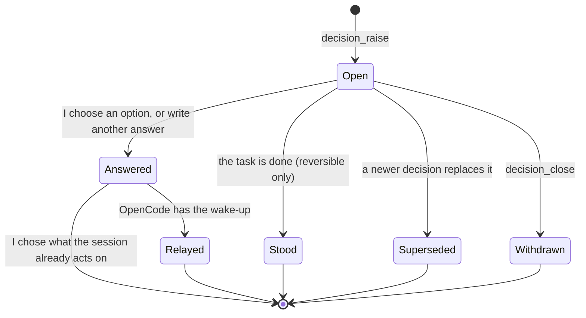

# Reports and decisions

Proposed, not built. A session says what I need to read in a short, typed
report, and asks for a choice with a decision that does not stop it. I read and
answer both in a web page that Ratchet serves, and answer OpenCode's own
question forms there too.

It replaces the `status`, `decision` and `done` tools in
`agent-setup/README.md`, and fills in the Decision cell in
[design.md](design.md#cells).

## What is wrong today

- A session ends a turn with a long message. To learn what it needs from me, I
  open the session and read it.
- A session that asks with the question tool stops until I answer. I take the
  recommended option almost every time.
- A question is answered only in the session's own window. Ratchet shows that
  one is open (`NeedsMe`) and not what it asks.
- Nothing carries a message from a session to me or to another session. A task's
  `outbox` in `src/hub/task.ts` holds wake-ups going into its sessions.

## Decided

| Topic | Decision |
| --- | --- |
| Outbox | A session's outbox is the list of reports on its current task. The session writes to it with one tool and never names a receiver |
| Report | A kind, a summary of at most 140 characters, and a detail of at most 600. A longer one is refused. The long text stays in the session |
| Decision | A cell of its own, with the question, two to four options and a recommended one. It is never edited, only superseded |
| A choice that can be undone | The session acts on the recommended option at once. I can choose another option until the task is done, which wakes the session |
| A choice that cannot be undone | The session waits. It works on something else or ends its turn, and my answer wakes it |
| Timers | None. A decision takes its default when it is raised, not after a wait |
| Question forms | Stay, for a turn that cannot go on without an answer and has no recommendation. Ratchet shows a form's fields and answers it through OpenCode's API. A form never takes a default: it does not say whether the choice can be undone |
| Where I answer | A web page served by Ratchet, over routes that any other surface can call |
| Receivers | Subscriptions on the task. Built first: the board. Later: the task that forked this one, the coordinator, a channel that reaches me |

## Reports

`report` records one report on the calling session's current task.

| Kind | The session says | Checked against | Effect on the task |
| --- | --- | --- | --- |
| `note` | Something I should know that needs nothing from me | Nothing | None |
| `blocked` | It cannot go on, and names what it waits for: a person, a pull request, a system | Nothing | `Blocked` once no session runs, until a session runs again |
| `done` | The task's work is finished | Every pull request the task owns has merged or closed, and no decision waits on me | `Done`. Decisions that took their default close |

A `done` that fails the check is refused, and the answer names what is still
open. A session that ends a turn after changing something for me reports it. A
task whose session went idle without a report since it last ran shows as
`Idle, said nothing` on the board, and nothing nags the session.

Work status on a pull request (`pr_set_status`) stays as it is: it says where
the work on one resource stands. A report says what I should read.

## Decisions

`decision_raise` takes a spec and refuses one that is incomplete.

| Field | Rule |
| --- | --- |
| Question | At most 140 characters |
| Context | The current state, and why the choice is mine. At most 600 characters |
| Options | Two to four. Each has a label and its effect: what changes, what it costs, what can go wrong |
| Recommended | One of the options, with the reason |
| Kind | `reversible`, with how the choice is undone. Or `waits`, with what the session cannot do until I answer |
| Supersedes | An earlier decision of the same task that this one replaces |

A session that cannot say how a choice is undone raises it as `waits`. So does
one whose choice changes production, deletes data, sends a message to people,
merges, spends money, or changes the scope or the design of the task.

The tool answers with the decision's ID and what to do now: act on the
recommended option, or do nothing that depends on the choice until an answer
arrives.

| Event | What happens |
| --- | --- |
| A `waits` decision opens | The task reads `NeedsMe` |
| A `reversible` decision opens | The task's tag does not change. The decision is listed under "took the default" |
| I choose the recommended option of a `reversible` decision | It closes. Nobody is woken |
| I choose anything else, or answer a `waits` decision | A wake-up goes to the task's session with the choice and my note, the way a resource's change does |
| The wake-up cannot be delivered | The decision stays `Answered` and the board shows it. An answer counts as acted on when OpenCode has the message, because the message starts a turn |
| I answer in the session's own window | The session closes the decision with `decision_close` and the option I chose |
| The question no longer matters | The session closes it with `decision_close` and the reason |

`task_current` lists the task's open decisions, so a session finds them again
after a compaction.

## Question forms and permission requests

The gateway already reads which forms and permission requests are open. It will
also read a form's fields and options, and reply through
`POST /api/session/{sessionID}/form/{formID}/reply` and
`POST /api/session/{sessionID}/permission/{requestID}/reply`. Both are in
OpenCode's `/openapi.json`, read on 16 November 2026. Neither is tried yet.

The question tool marks a recommended option by putting it first with
"(Recommended)" in its label. The page offers that option as one click.

The tool descriptions tell a session to raise a decision when it has a
recommendation, and to keep the question tool for a turn that cannot continue
without an answer. Whether sessions follow this is measured: the share of forms
whose first option is recommended. If it stays high, a permission rule that
denies the question tool to a session with a recommendation replaces the prose.

## Where I read and answer

| Route | Does |
| --- | --- |
| `GET /inbox` | What waits on me: `waits` decisions, question forms and permission requests, oldest first. Then what took a default, and the latest reports, newest first. Each item names its task |
| `POST /decisions/<id>/answer` | An option or a written answer, and a note |
| `POST /sessions/<id>/forms/<form>/reply` | A form's answer, passed to OpenCode |
| `POST /sessions/<id>/permissions/<request>/reply` | Allow once, allow always or reject, passed to OpenCode |
| `GET /` | The page over these routes |

An answer records who gave it: me on a named surface, the session after I
answered in its window, or later the coordinator.

## How it is stored

| Record | Lives in | Index |
| --- | --- | --- |
| Report | The task cell, the latest 50 | A `reports` table in D1 |
| Decision | A `Decision` cell, with `dec_` IDs | A `decisions` table in D1 |
| Open decisions of a task | The task cell, as IDs | The same table |

The task cell's `outbox` field becomes `wakes`, so that "outbox" names one
thing. Every new field on a stored state gets a decoding default and a shape in
`src/hub/stored-state.test.ts`.

## Receivers

A subscription is a receiver and the kinds it takes.

| Receiver | Takes | Delivered as | Built |
| --- | --- | --- | --- |
| The board | Everything | The index, read by the page | First |
| The task that forked this one, when `task_fork` made it | `done`, `blocked` | A wake-up to its session | After the page |
| The coordinator | Not decided | A wake-up, batched | When its role is decided |
| A channel that reaches me away from the page | `waits` decisions, `done` | Not decided | Later |

## Build order

1. `report`, the task's reports, the index and `GET /inbox` with reports only.
2. The `Decision` cell, `decision_raise`, `decision_close`, the answer route and
   the wake-up.
3. Form fields and the two reply routes through the gateway.
4. The page.
5. `done` checked against the task's pull requests, and the `Done` and `Blocked`
   tags.
6. Reports back to the task that forked.

Two numbers say whether it works: how often I choose another option than the
recommended one on a `reversible` decision, and how many question forms still
carry a recommendation.

## Open

1. Whether a `reversible` decision should hold the session for a few minutes
   before it takes the default. This design says no: a wait stops every session
   for the rare case, and a choice that can be undone costs little to change. If
   I overrule often, the first number above shows it.
2. How the page is reached from my laptop. The service listens on loopback on
   the dev VM. Anything wider than an SSH forward needs a sign-in on the answer
   routes.
3. Whether a `waits` decision should reach me outside the page, and where.
4. Whether the coordinator may answer a decision for me, and which reports reach
   it.
